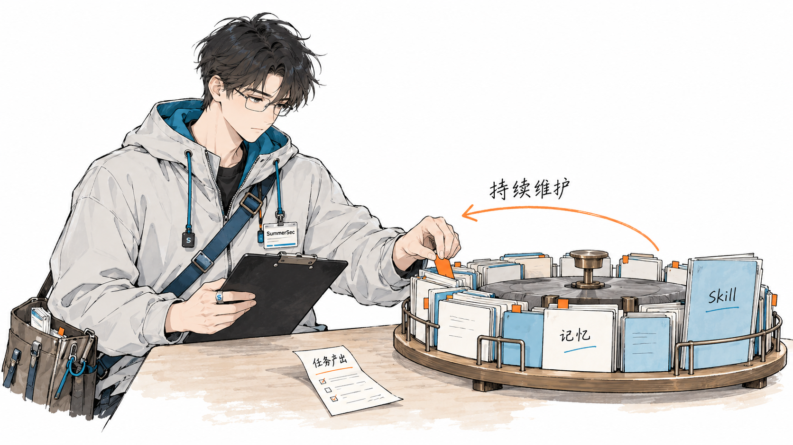
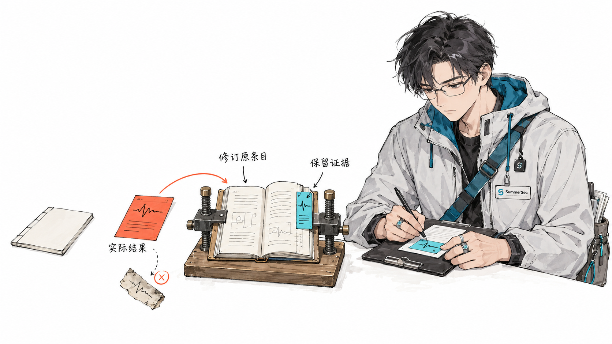

Agent 修好了一个问题，顺手写了份 Skill，又存下几条记忆。下次碰到类似任务，读一下，确实省事。

麻烦在后面。依赖升级了，入口挪了，当初绕过的限制早就消失了，那份 Skill 还在教它走旧路。记忆里那句“这个接口不能改”，也没人记得是哪个版本的事。

新任务还在继续，新的 Skill 和记忆照样往里塞。最后总得有人收拾。

如果这个人一直是我，那 Agent 省下的开发时间，有一部分只是换成了维护知识库的时间。我不太愿意接这个活。

[上一篇](./skill-lifecycle.html)写 Skill 怎么从候选变成正式能力，什么时候该合并、该归档。这次我想说清楚谁来做：**Agent 产生的 Skill 和记忆，也该由 Agent 管到最后。** 生成、验证、入库、使用后的反馈，以及过期之后怎么退出，都算它的工作。

下面是我希望落地的一套做法，讨论的是项目知识和操作方法的维护。现成工具已经提供了一些零件，整套治理仍需要项目自己接起来。



## 写下来之后，活还没完

人写 Skill、人整理记忆，Agent 负责读，这种分工在内容少的时候还行。现在 Agent 已经会主动提炼方法、保存调查结论，还会在下一个任务里引用它们。维护责任也得跟过去。

比如一次排查结束，Agent 发现了一个可复用的办法。它先搜已有内容：有对应条目，就补进去；确实没有，再建候选。接着检查证据，标出适用范围，决定能否入库。要是这次结果推翻了旧结论，还得去处理旧条目。

这比“修好了，已记录到记忆”多做了不少事，但少做这些，问题只是留到下一次。

任务开始时同样要维护。Agent 找到一条旧经验，要核对它对应的版本和环境。对不上，就先降为待复核，别拿着几个月前的结论直接改当前代码。

## Skill 和记忆，分别管什么

我习惯先看内容的用途。

项目 Skill 是以后还要照着执行的方法：什么时候用，需要哪些输入，怎么做，怎么验。项目记忆则保留当时的事实和决策：发生过什么，为什么选这个方案，证据在哪，在什么条件下成立。

拿告警查询超时举例，下面都是假设的材料：

| 产物 | 留下什么 | 以后检查什么 |
| --- | --- | --- |
| 项目 Skill | 定位查询、构造回放样本、验证修复的方法 | 步骤能否执行，是否误触发，验证有没有漏项 |
| 项目记忆 | 某次慢查询的根因、数据规模、方案取舍 | 证据能否找到，结论是否仍适用于当前版本 |
| 任务记录 | 查过的日志、试过的方向、执行过的命令 | 哪些证据值得保留，剩下的何时清理 |

Skill 可以引用记忆，记忆也会写到操作经验。不用为了分类漂亮，把内容切得支离破碎。分开管理，主要是因为它们的验法不同。


[Agent Skills 规范](https://agentskills.io/specification)提供了 `SKILL.md`、脚本和参考资料的组织方式；[Claude Code 的记忆机制](https://code.claude.com/docs/en/memory)支持跨会话保留项目经验。知识能留下来，也能被读到。接下来要补的是：Agent 怎么判断它该不该继续用。

## 新经验，先放候选

一次修复成功，还不足以把方法写成项目规则。

“修改查询后变快了”，就一定是原来的查询有问题吗？缓存热了没有，数据量是不是少了，并发有没有变？这些没对照过，只能先记为假设。

我会先让 Agent 给产物登记一个身份：标识、版本、适用范围、来源任务和证据位置。状态可以从简单的几种开始：

```text
任务产生线索 → 候选 → 验证 → 生效 → 使用与反馈
                       ↑               ↓
                       └── 修订、合并 ──┘

发现前提变化 → 待复核 → 恢复使用 / 归档 → 按策略删除
```

这些是项目约定，得接进发现机制和检索流程才有用。文件里多写一个 `status: archived`，工具照样可能把它读进来。

候选阶段也要克制。“接口为什么保留旧字段”值得记，因为代码通常解释不了当年的取舍；“某个类在哪个目录”随手就能查到，没必要再维护一份容易过期的副本。一次测试环境临时不通，留在任务记录里也许就够了。

轮到验证时，两类产物分开验。

Skill 要试着执行。Agent 可以在隔离环境重现问题，拿历史样本回放，还要试几个相近但不适用的任务。普通网络抖动也触发了查询优化 Skill，就说明触发条件写宽了。

记忆要核对事实和条件。哪个版本、什么环境、用了哪些数据，证据支持到哪里，就写到哪里。查不到的部分保留为待验证，别为了让记录完整而补一个听起来合理的结论。

改了 Skill 的关键步骤，就重新跑对应验证；扩大记忆的适用范围，也要补新证据。旧版本那次通过，不能一直沿用。

## 入库，不必每条都等人点头

如果所有候选都排队等人确认，维护工作迟早又会回到人手上。

我更愿意提前把权限和验收条件定好。整理任务记录、去掉重复索引、标记失效内容，这些日常维护可以交给 Agent。证据完整、范围明确的低风险记忆，也可以自动入库。

会改变默认工作方式的 Skill 更新，要求高一些：有回归用例，能和旧版比较，改错了能回滚，而且属于已经授权的范围。扩大工具权限、改发布流程这类变化，再交给对应的人判断。

权限要落在工具配置、仓库权限和 CI 上。只在说明里写“不要越界”，拦不住一次实际操作。

记忆也不能给自己发权限。“上次允许发布”是一段历史，下次能否发布，要看当前任务和有效的授权。网页或日志里夹带的指令，即便被存进记忆，也不能因此变成项目规则。

人把边界定清楚以后，Agent 就应该在范围内把活做完，别每整理一张索引卡都回来问一次。

## 旧经验，要拿到现场再看一遍

假设记忆里有一句：“告警查询超时曾由深分页导致。”

它能提醒 Agent 去查当前请求有没有深分页。查过以后，才知道这条经验本次有没有用。项目已经改了查询方式，旧结论就应该留在历史里，退出当前默认建议。

暂时访问不了证据，则是另一回事：标记尚未复核，等条件具备再查。查不到和查证为错，不能混为一谈。

读取时先按项目、模块和任务筛选，再核对版本、环境和失效条件。很多时候，Agent 只需要几条相关经验。把整个知识库塞进上下文，过期条目反而更容易干扰判断。

## 用完以后，留下具体反馈

“被读取过”只能说明搜到了。“任务完成了”也不能证明 Skill 有效，说不定 Agent 放弃那套步骤之后才修好。

我更想看到这种使用记录：

```text
使用对象：alarm-query-troubleshooting，版本 3
触发原因：告警检索 P95 延迟升高
执行结果：回放步骤有效；旧日志路径已失效
记忆核对：历史上的深分页结论不适用于本次请求
维护动作：修订日志定位步骤；补齐旧记忆的适用条件
```

这是示意，实际记录还要能追到任务、代码版本、输入条件和证据。反馈写到这一步，下一次维护就有明确的改动对象。



某一步连续失败，就检查脚本、环境和前提；用户纠正了结论，就找出引用它的地方；一条记忆被当前证据推翻，就重新评估它的范围。这些都能由任务直接触发，不必攒到月底再整理。

使用次数可以帮助挑出要复核的内容，却不能单独决定去留。低频的故障恢复流程，可能很久才用一次，删早了更麻烦。

## 重复的合并，冲突的查证

Agent 每次都新建文件，很快就会有四五份名字相近的超时排查 Skill。维护时要比较触发条件、步骤和验证方法，再决定是否合并。只看名字，容易把不同问题揉在一起。

记忆合并也要保留条件。测试环境的结果和生产环境的结果，可以互相引用，未必能压成一句统一结论。

遇到冲突，先查版本和范围。例如：

```text
旧记忆：查询必须经过兼容层。
新证据：新版本已移除兼容层，迁移验证通过。

维护动作：
1. 给旧记忆补齐适用版本。
2. 更新当前版本的结论及证据。
3. 修订仍在引用旧路径的 Skill。
4. 让当前版本的默认检索退出旧结论。
```

新记录只是时间更晚，证据不一定更强。Agent 比较之后仍解释不了冲突，就把两边依据摆出来，让人处理剩下的分歧。

这里还有个容易漏的活：处理引用关系。记忆被推翻，相关 Skill 要复核；Skill 退出了，入口索引也要更新。只改正文，其他地方继续引用旧结论，这次维护就没做完。

## 归档了，就得真正退出检索

依赖升级、模块迁移、接口删除，都可以触发一次定向复核。Agent 根据变更找到受影响的条目，检查它们依赖的路径、版本和证据。

复核日期到了，表示该检查了。前提确实变了，才说明原结论可能不再适用。别把“太久没看”直接当成“已经过期”。

确认退出以后，除了把文件放进归档目录，还要处理发现入口和检索索引。向量索引仍然返回旧内容，或者另一份 Skill 还要求读取它，归档就没有完成。


归档时保留替代条目、退出原因和必要的证据，方便以后回查。物理删除则按项目的数据保留策略处理，正文、附件、缓存、派生索引和历史副本都要纳入范围。需要恢复的旧内容，也得先复核再重新生效。

## 放回一次任务里看

仍然用前面那个假设的告警查询超时任务：

| 阶段 | Skill 的维护 | 记忆的维护 |
| --- | --- | --- |
| 开始排查 | 找到既有方法，确认适用范围 | 核对历史记录与当前请求 |
| 定位问题 | 发现步骤缺少一种查询模式 | 保存本次假设和对应证据 |
| 完成验证 | 用回放样本验证新增步骤 | 确认结论的适用条件 |
| 结束任务 | 在授权范围内更新并验证新版 | 入库带证据和复核条件的记忆 |
| 后续使用 | 记录步骤效果和误触发 | 记录命中、失效或反证 |
| 项目升级 | 修订、合并或替换旧方法 | 复核旧结论，处理检索和引用 |

执行任务和维护知识，开始时可以由同一个 Agent 分阶段做。任务多了，再考虑独立的维护 Agent 或定时任务。无论分给谁，验收都要看可复现的证据，换一个 Agent 点头并不算验证。

第一版可以先落在文件里。下面只是目录示意，实际发现路径和加载方式需要接入所用工具：

```text
project/
├── AGENTS.md                  # 项目入口、维护职责和权限边界
├── skills/                    # 已生效的操作方法
├── memory/                    # 可复核的事实与决策
└── governance/
    ├── index.yaml             # 标识、版本、状态、范围与依赖
    ├── candidates/            # 新产物和修改提案
    ├── evidence/              # 验证结果或证据引用
    ├── events/                # 使用反馈与状态变更
    └── archive/               # 已退出默认使用的历史版本
```

先接通候选、验证、生效和使用反馈，再让反馈能触发修订或退出。每次变化留下原因和版本，改错了能回滚，就已经能解决不少实际问题。

我希望任务结束时，Agent 除了交付代码，还能交代这几件事：更新了哪份 Skill，补充了哪条记忆，发现哪些旧结论不再适用，哪些分歧还需要我来判断。下一次打开项目，不用先替它清理上一轮留下的东西。
