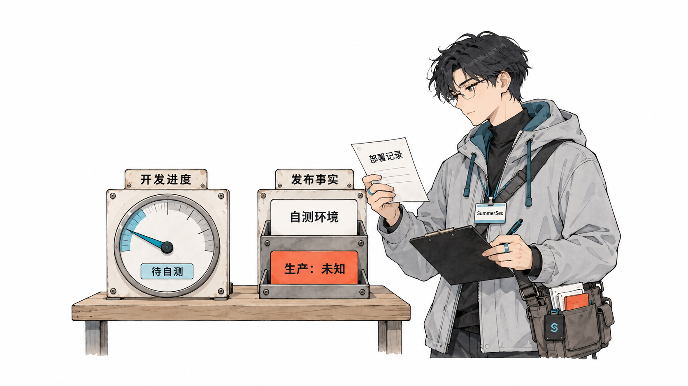

<section class="story-scene" data-scene="从自测里的字段改名开始" markdown="1">

## 一次自测修复，为什么多出了一层兼容 {#agent-unreleased-code-compatibility-opening}

一个需求讨论完、实现完，部署到自测环境。测出问题，再让 Agent 修，它却开始保护上一轮的实现：旧字段留着，新字段另加；错误逻辑没删，旁边再补一个分支。

有些所谓的旧代码，其实就是这个需求刚写出来的东西。确认还没发布、没有独立使用者、没有必须保留的数据后，本来可以直接修正，最后却多出了一组要长期维护的行为。

我手写一部分再交给 Agent，也可能碰到这种处理。只要代码已经摆在眼前，它就容易被当成需要保护的历史。

我想补上的，是修改前的一份依据：**这个需求走到哪一步，本次要改的东西究竟被谁使用。**


</section>

<section class="story-scene" data-scene="先问谁在使用" markdown="1">

## 兼容要保护真实使用者，不能只保护上一轮实现 {#旧代码到底有多旧}

用一个假设的字段改名串起后面的讨论。新需求增加 `type`，自测发现名称和含义不合适，准备统一为 `category`。定义和调用都属于本轮，数据也已确认无需保留，这时可以把相关位置一起修正。

Agent 却可能先留下一个兼容读取：

```javascript
const category = payload.category ?? payload.type;
```

这一行需要一个具体答案：谁还在传 `type`？

如果有已经发布的客户端在用，保留旧路径就有依据。只有“上一轮写过这个字段”，还不足以说明保留义务。继续维护两个字段，很快就要规定优先级、校验方式，以及两者同时出现时的行为。

一次字段改名由此变成了一套额外契约。


*旧实现需要保留的理由，要落实到具体使用者。*

因此，新增兼容之前先列出对象：哪个客户端、哪个服务、哪批必须保留的数据还依赖旧行为。提交、合并和部署记录都可以提供线索，但单独一项不能替代依赖判断。


</section>

<section class="story-scene" data-scene="进度和事实分别记" markdown="1">

## 开发做到哪一步，与外部正在使用什么，要分开记录 {#实现完成以后需求还在继续}

Agent 说“开发完成”，通常只结束了当前一轮实现。接下来还有部署、自测、修复和回归，发布仍要单独决定。

如果下一轮只剩一句“把这个字段改一下”，Agent 很难从现有代码还原这些阶段。所以记录里需要两条彼此独立的线：开发进度，以及部署和依赖事实。



开发进度可以是开发中、待自测、自测修复、待发布；实际使用情况则记录环境、生产流量、独立调用方和必须保留的数据。

两条线不会始终同步。需求尚未验收，其他团队可能已经接入联调；功能开关没开，数据库变更也可能早已执行。因此，“还在自测”不能成为任意删改的通行证。

判断要落在这次准备修改的字段、接口和逻辑上。老项目里新增一个需求，并不会让原有已发布行为失去保护。



*开发进度和发布事实分别记录，缺少依据的状态先留作未知。*


</section>

<section class="story-scene" data-scene="开发时自动关联" markdown="1">

## 需求开始时自动留下记录，修复才有背景可接 {#先解决记录从哪里来}

“每个需求建一份状态文件”听起来容易，问题是谁负责建立它。我通常只是把需求发给 AI，让它设计、实现；手写代码时，更不会为下一次 AI 修复预先准备一份记录。

因此，关联记录应该成为 Agent 接手需求时的一项常规动作：先查已有记录，没有就从对话和代码探索中补齐最小内容。方案变化、实现完成、自测反馈，都更新同一份。



记录目标、范围、开发起点和当前知道的发布依赖事实就够了。聊天全文没有必要搬进仓库。


*需求进入开发流程时自动留下记录，后续修复继续更新这一份。*

比如，一个新需求刚进入开发时，可以先留下这样的记录：

```yaml
id: order-category
goal: 为订单增加分类能力
scope:
  - 订单分类字段
  - 订单接口
  - 管理页面
start_commit: "开始开发前的提交 SHA"
stage: developing
deployment:
  environments: []
  production_exposure: unknown
  evidence: []
dependencies:
  external_consumers: unknown
  data_to_preserve: unknown
```

其中的 `unknown` 有明确含义：目前没有足够信息。记录刚建立，不能据此把代码判为未发布。

`start_commit` 也只用来帮助定位本轮修改。它不一定是生产版本；如果开始时工作区就有未提交代码，还要记录相关文件或差异，不能简单用这个提交之后的全部变更代替需求范围。

以后我说“只部署到了自测环境，还没有进入生产”，Agent 就把这个事实记下来，并注明依据来自这次反馈。数据能不能丢、有没有别的服务接入，如果没说，仍然留待查证。

记录可以放在 `docs/changes/`，也可以接入团队已有的需求单。目录名字没有那么要紧，后续任务能找到、能更新，才有用。敏感业务数据和凭据不该跟着聊天一起落进仓库。


</section>

<section class="story-scene" data-scene="修复继续同一需求" markdown="1">

## 字段改名继续原来的需求，不要每轮另起一份 {#修-bug-时继续接着这个需求做}

回到订单分类的假设案例。接到“设计并实现”时，Agent 关联或建立需求记录。实现完成，把阶段推进到待自测，发布状态继续沿用已有证据。

收到“自测发现字段不对”的反馈，再回到同一个需求，进入自测修复。此时核对 `type` 的实际使用情况，而不是仅凭它已经存在就加兼容。

确认属于本轮新增、没有必须保留的调用和数据后，同步修改定义、调用与测试，删除旧路径。修复结束仍回到待自测。这个循环可以发生多次，需求归属不需要每轮重建。

换了聊天，记录就能帮助恢复背景。需求编号、分支和修改文件都可以辅助匹配，但一个分支里可能有多个需求，文件也可能被反复修改，不能只凭“最近的一份”就认定归属。找不准时，问一句“这是继续修订单分类需求吗”就够了。

对于我已经手写了一半的需求，也可以从 Agent 接手时补建记录。它能确认的内容先写下，无法从对话和代码中确认的发布信息，再针对性核实。Git 差异能说明改了什么，不能证明哪些代码已经被人使用。


</section>

<section class="story-scene" data-scene="入口短，方法可维护" markdown="1">

## 入口负责关联需求，Skill 负责把记录用起来 {#规则负责提醒skill-负责具体步骤}

我会把“开始开发和修复时先关联需求”放在项目入口，具体的查找、更新和依赖判断放进 Skill。这样入口保持简短，操作方法可以单独维护。

以 Codex 为例，[官方文档](https://learn.chatgpt.com/docs/agent-configuration/agents-md)说明，`AGENTS.md` 用于提供项目指令；[Skill 文档](https://learn.chatgpt.com/docs/build-skills)则介绍了显式调用和按任务描述匹配的加载方式。因为 Skill 要经过调用或匹配，我会把“先关联需求记录”放在入口规则里。

下面是一份拟议的规则，尚未作为完整工具实现或验证：

```text
收到需求设计、实现或修复任务时，先查找对应的需求记录。
没有记录时，从对话和代码探索中自动补建最小记录。
不要要求用户额外提出“记录需求”，也不要为常规记录动作增加确认。

记录目标、范围、开发起点、阶段、部署事实和已知依赖。
已确认事实应注明依据；未知信息保留为未知。
设计调整、实现完成、自测反馈和发布后，更新同一份记录。

实现完成、测试通过、提交、合并或部署到自测环境，
均不能单独作为需求已经发布或必须兼容的依据。

修改前区分既有已发布行为与本需求新增实现。
已确认没有保留义务的本轮实现，优先直接修正并删除废弃路径。
新增兼容逻辑时，说明依赖对象、证据以及移除条件。
发布和依赖情况不明时，先查证，再决定如何修改。
```

这份方法可以叫 `change-lifecycle`，覆盖需求设计、开发、自测修复和发布反馈。它的交付很具体：记录关联正确，事实有依据，删改或兼容的决定可追查，结果写回原需求。

比如，结束修复时留下这样一句说明就够了：

> 本次调整涉及尚未发布的订单分类字段；调用方已同步修改，自测数据已确认无需保留，旧字段读取路径已删除。

确实要保留兼容，也写清楚原因：哪个已发布的客户端还在使用旧字段，等它升级到什么版本后可以删除。这样下次再读到这段分支，就不用重新猜。

单靠几段指令无法保证 Agent 次次执行。团队如果已经有需求系统和部署流水线，可以逐步把记录与实际发布结果关联起来。但起步时，我不会先做一套大系统，一份短记录加一条入口规则已经足够试运行。


</section>

<section class="story-scene" data-scene="按真实保留义务处理" markdown="1">

## 没有保留义务才直接改，有依赖就协调处理 {#自测环境也有需要留下的东西}

到这里，需要给“直接修正”补上完整条件。它适用于已确认没有保留义务的本轮实现；“还没上线”这句话本身并不足够。



自测环境里可能有需要保留的验证数据，联调方可能还在跑旧版本。数据库迁移如果已经执行过，直接修改原脚本，也不会自动修正现有数据库。要不要补迁移、是否允许重建环境，仍然得按实际情况处理。

联调方、保留数据和已执行迁移，都应写进记录。另一面也要明确：纯属本轮开发、没有使用者且无需保留数据的错误实现，可以统一修正，不必为了它曾经出现过而留下分支。

这套方法可以先用四种场景检查：未发布字段改名后旧路径能否删净；已发布接口的调用方能否被识别；换聊天后能否接回同一需求；一句“开发完成”会不会被误记成发布事实。

这篇提出的工作方式仍需要在真实需求中验证。我要的变化也很具体：可以直接修正的问题就一起改对、清掉废弃实现；确实要兼容的地方写清对象、证据和移除条件。下一轮再接手，这些依据仍然找得到。

</section>
